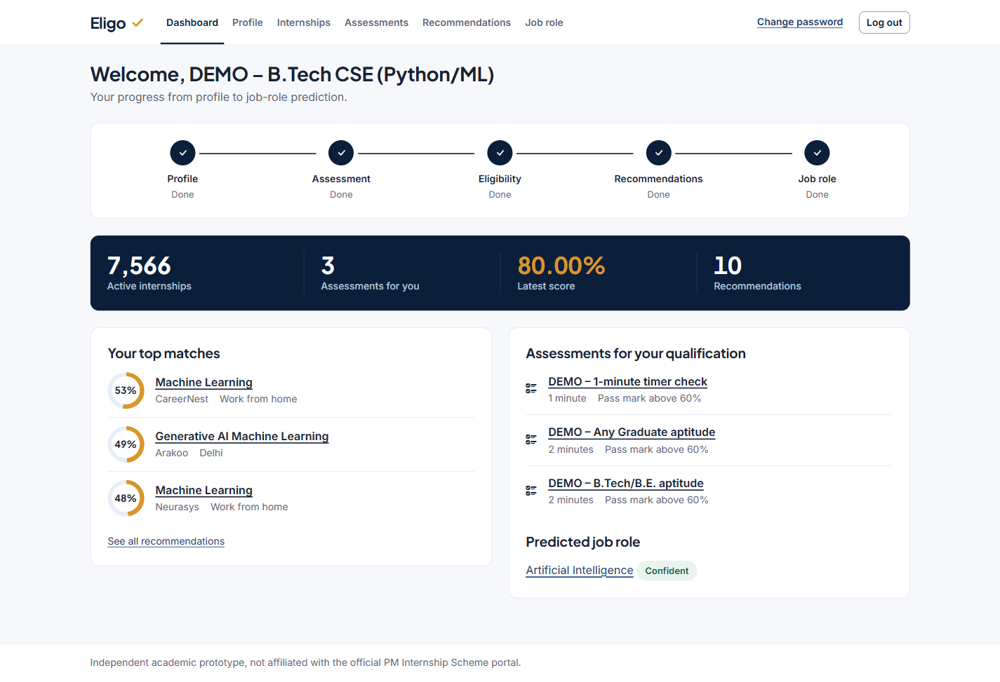
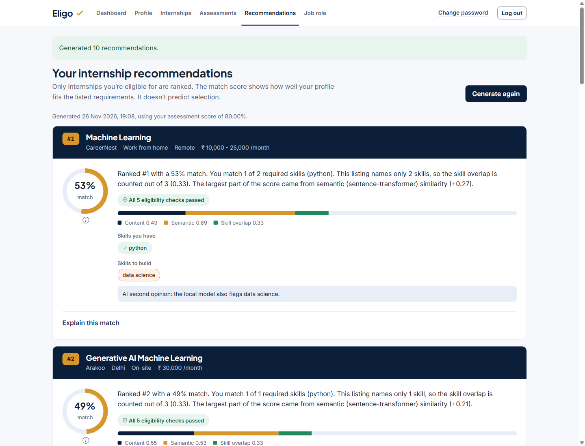
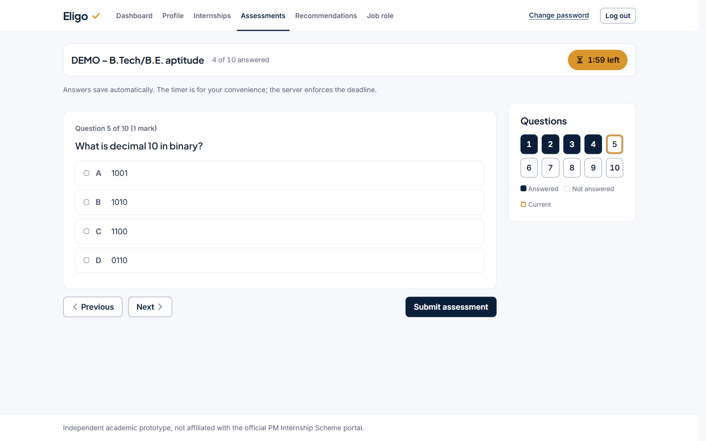
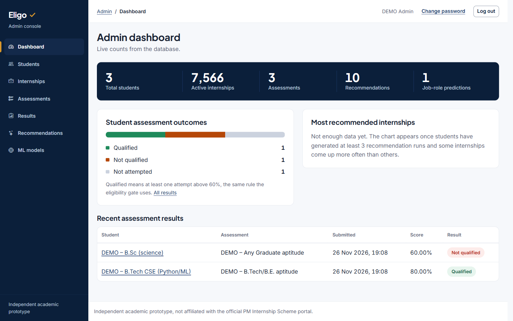
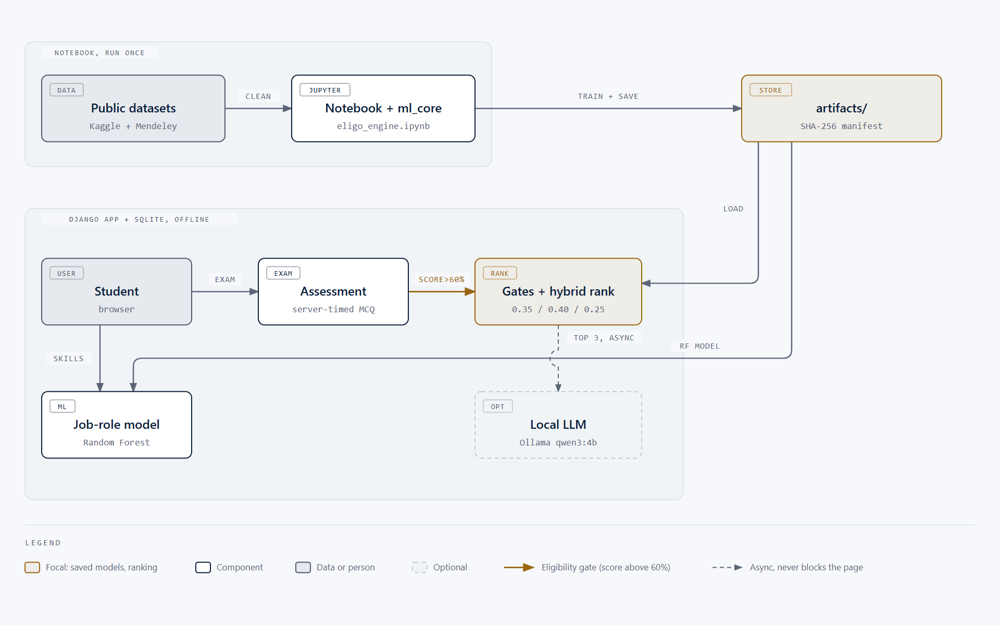

<p align="center"></p>

<p align="center"><strong>Eligibility-first, explainable internship matching</strong></p>

> Independent academic prototype, not affiliated with the official PM Internship Scheme portal.

Eligo is an internship recommender built in the context of India's PM Internship Scheme. A student fills in a profile and takes a short MCQ assessment for their qualification. Eligo then works out which internships they can actually apply to. It needs a score **strictly above 60%** and the required qualification, and only those internships get ranked. Each match comes with the numbers behind it, so a student can see why a listing ranked where it did. A separate model suggests a likely job role from the student's skills.

It's a Django and scikit-learn app that runs fully offline on an ordinary Windows laptop, with no cloud services or paid APIs.

## What it does

- Assessment first. Students see only the assessments for their qualification. The timer is enforced on the server, answers never reach the browser, and grading is automatic with exact decimal arithmetic. Submitting twice is rejected, and an abandoned exam is submitted automatically from the saved answers.
- Eligibility gates before ranking. Qualification, specialisation, academic percentage, deadline and the assessment score are hard gates. An internship that fails a gate is never ranked, however similar it looks. The student sees which gate failed instead.
- Hybrid matching. Each eligible internship gets three part scores: TF-IDF text similarity, sentence-transformer similarity (`all-MiniLM-L6-v2`) and skill overlap. They're weighted 0.35 / 0.40 / 0.25.
- Explanations from real numbers. Every card shows its score ring, the three weighted parts, matched and missing skills, and every eligibility check. "Explain this match" opens the full table.
- Optional local LLM. If Ollama is running, a small local model (`qwen3:4b`) reads the top 3 listings and gives a second opinion on missing skills. It runs after the page has loaded, so nothing waits for it. Without Ollama the rule-based check stands, and the page says which method was used.
- Job-role prediction. A Random Forest, chosen over a Decision Tree on test macro-F1, predicts one of six computer-science career fields from the skills a student picks. It reports its confidence and says plainly when a profile is outside what it knows.
- Admin side. Manage students, internships and assessments; monitor results and recommendation runs; check model metrics and the notebook's figures.

## Screenshots

| | |
|---|---|
|  |  |
| Student dashboard | Ranked recommendations with score rings and breakdowns |
|  |  |
| Exam: timer pill and question grid | Admin dashboard |

All 15 screenshots, in demo order, are listed in [docs/screenshots/README.md](docs/screenshots/README.md).

## How it fits together



1. The notebook (`notebooks/eligo_engine.ipynb`) cleans the two public datasets, trains and compares the job-role models, fits the TF-IDF vectorizer and encodes every internship with the sentence model. It saves all of this to `artifacts/` with a SHA-256 manifest.
2. `ml_core/` is the shared Python package. The notebook and the web app call the same functions for cleaning, gates, scoring, explanations and prediction, so the two can't drift apart.
3. The Django app loads the artifacts only after checking every file against the manifest. It never retrains anything. If an artifact is missing or changed, pages show a clear message instead of crashing.

The source for the diagram is [docs/img/architecture.html](docs/img/architecture.html).

## How a match is scored

| Step | Rule |
|---|---|
| Assessment | score = obtained marks ÷ total marks × 100, in `Decimal`. Qualified only if the score is **above 60%**; exactly 60.00% is not qualified. |
| Gates | Qualification (with a degree hierarchy), specialisation, minimum academic %, deadline, assessment. All must pass. |
| Content | Cosine similarity of TF-IDF vectors (profile text vs listing text) |
| Semantic | Cosine similarity of sentence-transformer embeddings |
| Skill overlap | matched ÷ max(required, 3). A listing that names only one skill can't score a perfect 1.00 by matching it (D-030). |
| Final | 0.35 × content + 0.40 × semantic + 0.25 × skill overlap, from `artifacts/config/hybrid_config.json` |

The match % shows how well a profile fits a listing's stated requirements. It is not a chance of being selected.

## Results

Job-role model on the held-out test split. The data is the Student Career Dataset after cleaning: 1,620 rows, of which 324 are held out for testing, and 188 skill features.

| Model | Accuracy | Precision (macro) | Recall (macro) | F1 (macro) | F1 (weighted) |
|---|---|---|---|---|---|
| Decision Tree | 0.7994 | 0.7990 | 0.8161 | 0.8033 | 0.7979 |
| **Random Forest** (saved) | **0.8642** | 0.8812 | 0.8644 | **0.8670** | 0.8645 |

Per class (Random Forest, F1): Artificial Intelligence 0.855, Data Science 0.863, Development 0.885, Security 0.838, Software Development and Engineering 0.872, UX/UI Design 0.889. The UX/UI class has only 5 test rows, so its score moves a lot with a single prediction.

The recommender has no relevance labels to measure accuracy against, so no recommendation accuracy is claimed. The notebook shows how stable the ranking is under different weights instead.

## Datasets

| Dataset | Used for | Licence |
|---|---|---|
| [Student Career Dataset v2](https://data.mendeley.com/datasets/4spj4mbpjr/2) (Mendeley Data, DOI 10.17632/4spj4mbpjr.2) by Sakir Hossain Faruque and Sharun Akter Khushbu | Job-role model | CC BY 4.0 |
| [Internship Opportunities in India (2025)](https://www.kaggle.com/datasets/jayaantanaath/internship-opportunities-in-india-2025) (Kaggle, `jayaantanaath`) | Internship listings | MIT (as declared by the uploader) |

Both are real data. Cleaning keeps one copy of repeated listings, which takes the 8,483 raw postings down to 7,566. Details, profiling and known limits are in [docs/DATASETS.md](docs/DATASETS.md). The demo students and demo assessment questions are illustrative, marked DEMO everywhere, and never used as training data.

## Setup (Windows, PowerShell)

You need Python 3.12 and about 2 GB of free disk space (most of it is PyTorch).

```powershell
git clone https://github.com/Krishna141414/eligo-internship-engine.git
cd eligo-internship-engine
py -3.12 -m venv .venv
.\.venv\Scripts\python.exe -m pip install torch==2.15.0 --index-url https://download.pytorch.org/whl/cpu
.\.venv\Scripts\python.exe -m pip install -r requirements.txt
.\.venv\Scripts\python.exe scripts\setup_sentence_model.py     # one-time download of all-MiniLM-L6-v2, checked byte for byte
.\.venv\Scripts\python.exe manage.py migrate
.\.venv\Scripts\python.exe manage.py load_internships
.\.venv\Scripts\python.exe manage.py seed_demo                  # DEMO students and DEMO assessments
.\.venv\Scripts\python.exe manage.py create_admin
.\.venv\Scripts\python.exe manage.py runserver
```

Open http://127.0.0.1:8000/. Installing torch from the CPU index first avoids the 2.5 GB CUDA build.

The pip installs and the sentence-model download are the only steps that need internet. After that Eligo runs offline: the trained models, cleaned data and embeddings are in the repository, and every third-party CSS, JS and font file is vendored in `static/vendor/`.

For the optional local LLM, install [Ollama](https://ollama.com), run `ollama pull qwen3:4b`, then `python manage.py warm_llm` to load it before a demo. Eligo works the same without it.

### Rebuilding the models (optional)

The saved artifacts are enough to run the app. To retrain them, download the two datasets into `data/raw/mendeley_student_career/` and `data/raw/kaggle_internships_2025/` (see [docs/DATASETS.md](docs/DATASETS.md)). Then run:

```powershell
.\.venv\Scripts\python.exe -m ipykernel install --user --name eligo
.\.venv\Scripts\jupyter.exe nbconvert --to notebook --execute notebooks/eligo_engine.ipynb --output eligo_engine.ipynb --ExecutePreprocessor.kernel_name=eligo --ExecutePreprocessor.timeout=1800
.\.venv\Scripts\python.exe manage.py load_internships --refresh
```

`--refresh` updates the internships already in the database and retires any that the new data no longer contains. It never deletes them, because old recommendations still point at them.

## Demo accounts

`seed_demo` creates three DEMO students (`demo.cs@eligo.local`, `demo.bba@eligo.local`, `demo.bsc@eligo.local`, password `Eligo-DEMO-2026!`) and three DEMO assessments. `reset_demo` puts them back to a clean state. It also removes test accounts (emails on test domains such as `example.com`, or "DEMO" names that aren't one of the three). It never touches real students or admins.

## Demo checklist

1. Optional: start Ollama with the `qwen3:4b` model (`ollama list` should show it). Eligo never depends on it. Without Ollama, the rule-based skill check runs and the page says so.
2. Warm the local LLM so the first AI second opinion isn't slow:
   ```powershell
   .\.venv\Scripts\python.exe manage.py warm_llm
   ```
   It loads the model into memory and keeps it warm for 30 minutes (`--keep-alive 1h` to change that). `runserver` also starts a warm-up in the background without blocking; set `ELIGO_WARM_LLM=0` to turn that off.
3. Start the server: `.\.venv\Scripts\python.exe manage.py runserver`, then open http://127.0.0.1:8000/.
4. Student flow: log in as a DEMO student, take the assessment for the profile's qualification, then select "Generate recommendations". The ranked cards appear in about 3 seconds. The top 3 cards then show "AI second opinion: checking…" while the local model cross-checks them one at a time. The page never waits for it.
5. Job role: open "Job role" and select "Predict my job role". It uses only the career skills picked in the profile.
6. Admin: log in with the admin account to see the dashboard, results, recommendation runs and the ML monitoring page.

## Viva demo script (about 5 minutes)

Before the viva (once, with an admin account already made by `create_admin`):

```powershell
.\.venv\Scripts\python.exe manage.py reset_demo     # DEMO students back to a clean state; never touches other data
.\.venv\Scripts\python.exe manage.py warm_llm       # optional: loads qwen3:4b so the AI second opinion is quick
.\.venv\Scripts\python.exe manage.py runserver
```

The DEMO assessments are 2 minutes long, so answer briskly. The answer keys below come from the illustrative DEMO questions in `recommendations/management/commands/seed_demo.py`. The exam page itself never sends answers to the browser.

### 1. CS student qualifies at 80% (about 2 minutes)

1. Log in as `demo.cs@eligo.local`. The dashboard shows the journey stepper at "Assessment".
2. Assessments → "DEMO – B.Tech/B.E. aptitude" → Start assessment.
3. Answer questions 1 to 8 correctly (B, B, B, C, B, D, B, C) and questions 9 and 10 with A. Point out the timer pill and the question grid.
4. Submit assessment → the confirm dialog shows 0 unanswered → Submit now. Result: **80.00%, Qualified**, with the 60% marker on the ring.

### 2. Recommendations and the explanation (about 1.5 minutes)

1. Continue to recommendations → Generate recommendations. "Analysing your profile… checking 7,566 internships" shows while it ranks (about 3 seconds).
2. Ten ranked cards appear. Only eligible internships are ranked. The top 3 say "AI second opinion: checking…" and fill in a few seconds later without reloading. Without Ollama they say the second opinion isn't available and the rule-based check stands.
3. On card #1, hover the ⓘ next to the score ring for what the % means, then open "Explain this match": part scores × weights = the final score, plus every eligibility check. Click the title for the full explanation page.

### 3. Job role (about 30 seconds)

- Job role → Predict my job role. The DEMO CS profile is predicted as Artificial Intelligence with high confidence (96% on the current model), with the probability chart and the skills that weigh most.

### 4. B.Sc student at exactly 60% is not qualified (about 1 minute)

1. Log out, then log in as `demo.bsc@eligo.local`.
2. Assessments → "DEMO – Any Graduate aptitude" → Start assessment.
3. Answer questions 1 to 6 correctly (C, C, B, B, B, C) and questions 7 to 10 with A, then submit.
4. Result: **60.00%, Not qualified**, because Eligo needs a score strictly above 60%. Recommendations stay locked for this student.

### 5. Admin dashboard (about 30 seconds)

- Log out, log in with the admin account. The dashboard shows the stat band and the outcome bar: 1 qualified, 1 not qualified, 1 not attempted. With a single recommendation run, the "Most recommended internships" panel says "Not enough data yet"; the chart appears after 3 runs. Results lists both attempts, and ML models shows the Decision Tree and Random Forest metrics next to the notebook figures.

Optionally, show the "DEMO – 1-minute timer check" assessment: it submits itself when the timer runs out, and the server records it.

Run `reset_demo` again after a rehearsal so the viva starts clean.

## Tests

```powershell
.\.venv\Scripts\python.exe -m pytest tests -q
```

The suite has about 450 tests and runs in roughly 20 seconds. It covers every testing scenario in the specification: the 60.00% boundary, grading, simultaneous double submits, missing artifacts, cross-student access, the hybrid ranking and its gates. Tests in `tests/test_integration_artifacts.py` also run against the real saved models. A recorded browser run of the whole flow is in [docs/E2E.md](docs/E2E.md).

## Project layout

```
ml_core/          shared logic: cleaning, skills, gates, scoring, explanations, job role, artifacts
notebooks/        eligo_engine.ipynb (training, evaluation, figures)
artifacts/        saved models, vectorizer, embeddings, configs, metrics, figures, manifest.json
accounts/ students/ internships/ assessments/ recommendations/ adminpanel/   Django apps
templates/ static/   Django templates, theme.css, small vanilla JS files, vendored Bootstrap/Chart.js/fonts
tests/            pytest + pytest-django
docs/             spec, decisions, datasets, requirements checklist, audit, E2E run, screenshots
```

## Limitations

- No relevance labels. No public dataset says which internships suited which students, so the recommender's quality is shown through explanations and weight sensitivity, not an accuracy score.
- Skills-only job-role model. The training data has no academic or assessment fields, so the model uses skills alone. It covers six computer-science career fields and says so when a profile falls outside them.
- Composed descriptions. The internship dataset has no full descriptions; Eligo builds one from each listing's title, company, required skills, eligibility notes and perks, and marks it as composed.
- A snapshot. The listings were scraped in September 2025. Deadlines for imported listings are checked against that date, so the demo stays meaningful.
- Optional LLM. The local model's second opinion is a cross-check only. It never changes the score, and it needs Ollama with `qwen3:4b` installed.
- Prototype scope. No government portal integration, real allocation, payments or employer accounts.

## Documentation

- [docs/PROJECT_SPEC.md](docs/PROJECT_SPEC.md): the requirement specification
- [docs/DECISIONS.md](docs/DECISIONS.md): every design decision, with the options considered
- [docs/REQUIREMENTS_CHECKLIST.md](docs/REQUIREMENTS_CHECKLIST.md): each requirement mapped to the file or test that meets it
- [docs/DATASETS.md](docs/DATASETS.md), [docs/AUDIT.md](docs/AUDIT.md), [docs/E2E.md](docs/E2E.md)

## Licence

The code is MIT-licensed (see [LICENSE](LICENSE)). The datasets keep their own licences, listed above. The Student Career Dataset is CC BY 4.0: please cite Faruque and Khushbu (2024), DOI 10.17632/4spj4mbpjr.2.
